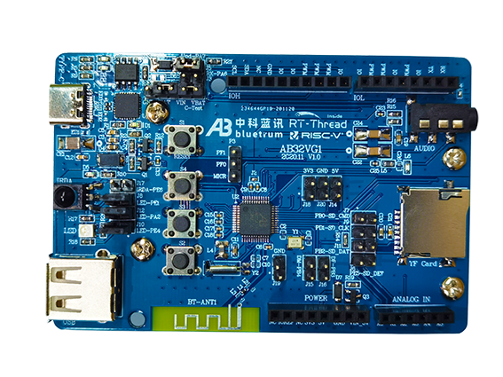

# AB32VG1 开发板探索

## 关于本项目

这个项目围绕中科蓝讯 AB32VG1 开发板，分析官方闭源 SDK 中的 `libhal.a`、`libbtctrl.a` 和 Windows 配套工具，逐步恢复可阅读的驱动实现，并完善裸机示例和 Linux 开发流程。

官方资料并不完整，已收集的文档放在 `docs/`。逆向结论、实现和验证记录会一并保留，方便后续继续分析和上板核对。

## 项目目录

| 目录 | 内容 |
| --- | --- |
| [bare/](bare/README.md) | 裸机工程、外设驱动和应用示例 |
| [rtt/](rtt/README.md) | RT-Thread 工程与 BSP |
| [tools/linux/](tools/linux/README.md) | Linux DCF 打包、串口下载和检查工具 |
| [docs/](docs/README.md) | 芯片与开发板资料 |
| [docs/lib-analysis/](docs/lib-analysis/README.md) | SDK 库分析、驱动恢复和验证记录 |

## 当前进展

| 项目 | 进展 |
| --- | --- |
| 硬件 SPI1 | 已恢复 C 实现，通过原库差分测试和链接检查，待上板验证；见 [SPI/I2C 分析](docs/lib-analysis/SPI_I2C_RECOVERY.md) |
| 音频输入/输出 | 已恢复模拟输入与 SDADC 共 18 个函数，通过 3490 项原库差分测试；新增 48 kHz 双声道硬件 DAC 播放，DMA 采集 ABI 已修正，实机录放与 I2S 待完成，见 [音频分析](docs/lib-analysis/AUDIO_RECOVERY.md) |
| 硬件 I2C | 当前 SDK 中尚未找到可恢复的硬件实现，仍需寄存器资料或其他固件证据；现有 BSP 使用软件 I2C |
| FM 收音机 | 已恢复模拟/数字通路 10 个函数，修正调谐参数，通过 332 项原库差分测试；搜台、音频链路及实机收音待完成，见 [FM 分析](docs/lib-analysis/FM_RECOVERY.md) |
| 蓝牙 | 已恢复两个 HCI 消息对象及部分中断适配，完成原库差分和传输行为探测；仍依赖控制器/RF/ROM，板级配置与通信待验证，见 [蓝牙分析](docs/lib-analysis/BLUETOOTH_RECOVERY.md) |
| USB | 已恢复控制器、端点、EP0 和 HID 共 33 个函数，通过 1066 项原库差分测试；标准请求派发、板级接入与 Linux 枚举待完成，见 [USB 分析](docs/lib-analysis/USB_RECOVERY.md) |
| SD 卡 | 已根据寄存器手册和公开 BSP 实现原生 SD0 一位总线、SDSC/SDHC/SDXC 512 字节块读写；板级时钟/DMA 接入及实卡验证待完成，见 [SD 分析](docs/lib-analysis/SD_RECOVERY.md) |
| DCF 打包 | 已实现 Linux 工具，默认打包路径通过原版机器码逐字节对照 |
| 串口下载 | 已恢复握手、loader 上传、Flash 擦写、CRC 校验和重启，通过离线测试，待上板验证 |

Linux 工具的命令、支持范围和验证方法见 [使用说明](tools/linux/README.md)，打包格式和下载协议分别记录在 [XMAKER.md](tools/XMAKER.md) 与 [DOWNLOADER.md](tools/DOWNLOADER.md)。

## TODO

- [ ] **FM 收音机**：初始化与手动调谐已恢复；继续恢复搜台流程，完成收音及音频输出示例与实机验证。
- [ ] **蓝牙**：HCI 消息层与部分中断适配已恢复，广播/扫描/连接入口已定位；继续恢复状态机，补齐板级运行条件并完成通信示例。
- [ ] **USB 通信**：底层端点、EP0 状态机和 HID 辅助函数已恢复；补齐标准请求与描述符派发、板级初始化，验证 Linux 枚举及通信。现有描述符是单字节多媒体按键 HID，通用双向通信尚未实现。
- [ ] **SD 卡读写**：硬件 SD0 初始化、容量识别与单块读写已实现；完成板级 DMA 接入、实卡验证及文件系统集成。
- [ ] **音频接口**：模拟输入/SDADC 已恢复，硬件 DAC 播放与部分写入接口已实现；确认采集 DMA 格式/事件，完成实机录放、SD 连续供数及 I2S 驱动。

以上待办以裸机驱动恢复、示例和实机验证为目标。

## 开发板介绍

ab32vg1-prougen 是 中科蓝讯(Bluetrum) 推出的一款基于 RISC-V 内核的开发板，最高主频为 120Mhz，该开发板芯片为 AB32VG1。

开发板外观如下图所示：

该开发板常用 **板载资源** 如下：

- MCU：AB32VG1，主频 120MHz，可超频至 192MHz，8Mbit FLASH ，192KB RAM。
- 常用外设
  - LED: RGB灯
  - 按键: 3 个, USER(s2,s3) and RESET(s1)
- 常用接口：USB 转串口、SD 卡接口

## RT-Thread BSP 外设支持

以下记录 RT-Thread BSP 的外设支持情况；裸机驱动逆向进展见上节。

| **板载外设** | **支持情况** | **备注**                                  |
| :----------- | :----------: | :---------------------------------------- |
| USB 转串口   |     支持     |                                           |
| SD卡         |     支持     |                                           |
| IRDA         |     支持     |                                           |
| 音频接口     |     支持     | 支持音频输出                              |
| **片上外设** | **支持情况** | **备注**                                  |
| GPIO         |     支持     | PA PB PE PF                               |
| UART         |     支持     | UART0/1/2                                 |
| SDIO         |     支持     |                                           |
| ADC          |     支持     | 10bit SRADC  16bit SDADC                  |
| SPI          |   即将支持   |                                           |
| I2C          |     支持     | 软件 I2C                                  |
| RTC          |     支持     |                                           |
| WDT          |     支持     |                                           |
| FLASH        |     支持     | 对接 FAL                                  |
| TIMER        |     支持     |                                           |
| PWM          |     支持     | LPWM 的 G1 G2 G3 之间是互斥的，只能三选一 |
| FM receive   |     支持     |                                           |
| USB Device   |   暂不支持   |                                           |
| USB Host     |   暂不支持   |                                           |
