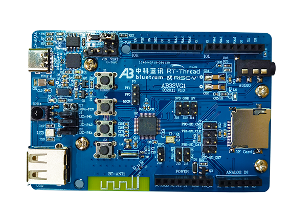

# AB32VG1 开发板探索

## 关于本项目

这个项目围绕中科蓝讯 AB32VG1 开发板，分析官方闭源 SDK 中的 `libhal.a`、`libbtctrl.a` 和 Windows 配套工具，逐步恢复可阅读的驱动实现，并完善裸机示例和 Linux 开发流程。

`rtt/` 是统一的综合应用工程，持续集成 FM、蓝牙、音频及其他外设功能。
各功能作为同一 RT-Thread 固件中的模块接入，统一规划内存、时钟、中断和共享外设；
功能裁剪和单模块测试服务于综合集成。FM 控制与 DAC 测试音已实测，广播接收仍待验证；
恢复源码的蓝牙控制器已接入 NimBLE 1.10.0，BLE 连接、ACL 分片、GATT 读写和通知已实测通过。

驱动开发以逆向厂家 `.a` 库、恢复可维护源码并逐步替换原对象为主线。
原库用于行为对照和阶段性差分验证；尚未替换的对象及芯片 ROM 调用必须明确记录，
不能把接入闭源库作为完成源码恢复的依据。NimBLE 等开源上层协议栈可正常使用。

官方资料并不完整，已收集的文档放在 `docs/`。逆向结论、实现和验证记录会一并保留，方便后续继续分析和上板核对。

## 项目目录

| 目录 | 内容 |
| --- | --- |
| [bare/](bare/README.md) | 裸机工程、外设驱动和应用示例 |
| [rtt/](rtt/README.md) | 综合 RT-Thread 工程与 BSP；[NimBLE 使用说明](rtt/NIMBLE.md)、[内存预算](rtt/MEMORY.md) |
| [tools/linux/](tools/linux/README.md) | Linux DCF 打包、串口下载和检查工具 |
| [docs/](docs/README.md) | 芯片与开发板资料 |
| [docs/lib-analysis/](docs/lib-analysis/README.md) | SDK 库分析、驱动恢复和验证记录 |

## 当前进展

| 项目 | 进展 |
| --- | --- |
| 硬件 SPI1 | 已恢复 C 实现，通过原库差分测试和链接检查，待上板验证；见 [SPI/I2C 分析](docs/lib-analysis/SPI_I2C_RECOVERY.md) |
| 音频输入/输出 | 已恢复模拟输入与 SDADC 共 18 个函数，通过 3490 项原库差分测试；新增 48 kHz 双声道硬件 DAC 播放，DMA 采集 ABI 已修正，实机录放待完成，见 [音频分析](docs/lib-analysis/AUDIO_RECOVERY.md) |
| I2S 输出 | 从另一份 AB53XX SDK 恢复 SRC 主机输出，136 组差分通过；RT-Thread 接入 `sound0`，16 位双声道、44.1/48 kHz，待实测；见 [I2S 分析](docs/lib-analysis/I2S_RECOVERY.md) |
| 硬件 I2C | 当前 SDK 中尚未找到可恢复的硬件实现，仍需寄存器资料或其他固件证据；现有 BSP 使用软件 I2C |
| FM 收音机 | 已恢复模拟/数字通路 10 个函数，通过 332 项原库差分测试；RTT 的调谐、音量、启停和资源互斥已上板验证，DAC 测试音经听感确认清晰稳定。北京 97.4 MHz 仍只有杂音，待更换耳机/天线复测；搜台、RDS 未完成，见 [FM 分析](docs/lib-analysis/FM_RECOVERY.md) |
| 蓝牙 | 已恢复 `libbtctrl.a` 全部非空成员，综合 RTT 不链接该归档。NimBLE 1.10.0 以 `rtt/nimble` 子模块接入；HCI、广播/扫描及六轮 BLE 连接、GATT 读写/通知/重连已实测，60 字节数据覆盖 ACL 分片；见 [控制器恢复](docs/lib-analysis/BLUETOOTH_RECOVERY.md) 与 [NimBLE 接入](rtt/NIMBLE.md) |
| USB | 已恢复 33 个底层函数、通过 1066 项原库差分测试；综合 RTT 新增 AB32 控制器适配和 CherryUSB CDC ACM 二进制回传，离线测试及编译通过。缺少独立 USB 数据线，尚未烧录本版、枚举或实机收发；见 [USB 接入](rtt/USB.md) |
| SD 卡 | 已根据寄存器手册和公开 BSP 实现原生 SD0 一位总线、SDSC/SDHC/SDXC 512 字节块读写；板级时钟/DMA 接入及实卡验证待完成，见 [SD 分析](docs/lib-analysis/SD_RECOVERY.md) |
| DCF 打包 | 已实现 Linux 工具，默认打包路径通过原版机器码逐字节对照 |
| 串口下载 | 已在 CH340/CRWN 实机完成 loader 上传、Flash 擦写、CRC 校验及首块提交；裸机串口及 RT-Thread 5.2.2 启动和 shell 通信均已验证，见 [实机记录](tools/linux/README.md#2026-11-02-实机记录) |

Linux 工具的命令、支持范围和验证方法见 [使用说明](tools/linux/README.md)，打包格式和下载协议分别记录在 [XMAKER.md](tools/XMAKER.md) 与 [DOWNLOADER.md](tools/DOWNLOADER.md)。

## 综合 RTT 快速使用

### 构建与下载

安装 SCons 并准备项目工具链后，在仓库根目录初始化 NimBLE 子模块再构建：

```sh
git submodule update --init rtt/nimble
cd rtt/bsp
scons -j4
```

子模块固定到 `nimble_1_10_0_tag`，上游源码未修改。固件打包与 CH340 串口烧录步骤见
[BSP 构建说明](rtt/README.md#linux-构建与驱动维护)。上电后红灯闪烁，FM 和蓝牙均不会自动启动；
烧录所用串口同时提供 **115200、8N1** 的 RT-Thread shell。

### FM 调试

复位开发板，插入 CTIA 标准 3.5 mm 有线耳机并展开耳机线。在串口中执行：

```text
fmrx tone
```

等待约 10 秒测试音结束，再执行：

```text
fmrx volume 20
fmrx start 97400
fmrx status
fmrx rssi
fmrx stop
```

`97400` 的单位为 kHz，即北京 FM 97.4 MHz。已确认测试音清晰稳定，
但当前耳机和环境下广播仍只有沙沙声，尚未完成收音验收。
`rssi` 为未标定原始读数，不能据此认定收到电台；更多诊断见 [FM 调试记录](rtt/README.md#fm-实机调试记录2026-11-02)。

### BLE 连接与 GATT

串口执行以下命令，不要先启动 `btctl test`：

```text
ble start
ble status
free
```

使用 BLE 调试 App 扫描 **AB32-NIMBLE** 并连接，即可测试自定义特征的 Read、Write 和 Notify。
iPhone 请在 nRF Connect 等 App 中扫描，不要以“设置 → 蓝牙”的设备列表作为发现依据；
详见 [iPhone 扫描说明](rtt/README.md#nimble-与-gatt-实机验证2026-11-02)。
当前为单连接、未加密测试服务，首选 MTU 64；UUID、通知订阅及电脑端复测脚本见 [NIMBLE.md](rtt/NIMBLE.md)。

保留 PCM 播放池和未分配 PCM 池的两种状态各完成三轮连接、读写/通知与重连，
载荷为 1、20、60 字节，HCI 传输错误和 Host 重置均为零，测试前后堆使用量不变。
接入 USB 前的已验证 NimBLE 版本总堆 **29736 字节**，蓝牙运行时可用 **11360 字节**；保留 PCM 播放池时可用
**2864 字节**。新增 USB 后链接的原始堆区为 **28320 字节**，运行时余量尚待实测，
不能沿用此前的可用堆数字。
详见 [内存记录](rtt/MEMORY.md#nimble-接入后) 和 [实机报告](docs/lib-analysis/generated/recovery/nimble-rtt-hardware.json)。

原生 USB CDC 已完成软件适配，上电关闭，通过 `usbcdc start/status/stop` 控制；
它使用独立 USB 数据口及 PB3/PB4，不走烧录 Type-C 的 CH340。
接线、待执行的 Linux 回传测试和内存限制见 [USB.md](rtt/USB.md)。

FM 与蓝牙目前仍互斥使用射频。`ble start` 会先停止 FM；蓝牙启动后即使执行
`ble stop` 停止广播，也需复位后才能重新运行 FM。`ble adv` 可恢复广播。
这六轮测试尚不覆盖手机兼容性、长期稳定性或 FM/蓝牙同时工作。

## TODO

- [ ] **FM 收音机**：更换已知符合 CTIA 接线的耳机/天线，在可接收环境验证真实广播；继续排查射频路径及初始化要求，恢复有效台判定、搜台与 RDS。控制命令成功和测试音正常不等于已收到广播。
- [ ] **蓝牙**：在已通过的单连接 GATT 基础上验证 iPhone/Android 兼容性、长时间运行及吞吐；按需求接入配对/绑定/加密，并重新评估内存及 FM/蓝牙射频共存。
- [ ] **USB 通信**：CDC Device 软件适配与离线测试已完成；准备独立 USB 数据线和数据跳线，下载后验证 Linux 枚举、二进制回传、拔插/复位及资源共存。Host、USB 音频和 MSC 尚未接入。
- [ ] **SD 卡读写**：硬件 SD0 初始化、容量识别与单块读写已实现；完成板级 DMA 接入、实卡验证及文件系统集成。
- [ ] **音频接口**：模拟输入/SDADC 已恢复，硬件 DAC 播放与部分写入接口已实现；确认采集 DMA 格式/事件，完成实机录放、SD 连续供数；I2S 硬件输出已接入，继续恢复 RX/DMA 并验证同系列寄存器兼容性。

以上待办包含底层驱动恢复、RT-Thread 综合项目集成、示例和实机验证。

## 开发板介绍

ab32vg1-prougen 是 中科蓝讯(Bluetrum) 推出的一款基于 RISC-V 内核的开发板，最高主频为 120Mhz，该开发板芯片为 AB32VG1。

开发板外观如下图所示：



该开发板常用 **板载资源** 如下：

- MCU：AB32VG1，主频 120MHz，可超频至 192MHz，8Mbit FLASH ，192KB RAM。
- 常用外设
  - LED: RGB灯
  - 按键: 3 个, USER(s2,s3) and RESET(s1)
- 常用接口：USB 转串口、SD 卡接口

## 外设驱动状态

**并非所有外设都已在 `bare` 中实现，也不能全部标记为可用。** 以下区分裸机实现、RT-Thread BSP 源码与当前启用状态。“已有实现”只表示有对应代码；“部分实现”表示还有关键路径缺失；两者都不等于已通过实机验证。当前裸机工程已通过 GCC 编译和链接，完整启动、时钟、IRQ、真实 DMA 内存布局及外设实测仍待完成。

本表依据仓库当前 [rtconfig.h](rtt/bsp/rtconfig.h)、[BSP 构建规则](rtt/bsp/libraries/hal_drivers/SConscript)、[板级配置选项](rtt/bsp/board/Kconfig)及 `bare/drivers/` 核对。当前 RT-Thread 配置启用了 GPIO、UART0、DAC 音频、FM、恢复源码的蓝牙控制器、NimBLE Host 和实验性 USB CDC；源码中可选的其他驱动不代表默认已编入固件。RT-Thread 的通用 USB/I2C 等框架也不能代替芯片控制器驱动。

| 板载外设/接口 | `bare` 当前状态 | RT-Thread BSP 当前状态 |
| --- | --- | --- |
| USB 转串口 | 裸机心跳程序已通过板载 CH340/UART0 单线双向通信验证，支持命令、文本回传和 LED 控制；见 [用法](bare/README.md) | UART0 已启用；这是外置 USB-UART 桥，不是片上 USB Device |
| RGB LED / 用户按键 | 已新增 PE1 红灯控制和独立裸机心跳，实机确认闪烁；通用 GPIO/按键驱动尚未实现 | 有 GPIO 驱动并已启用；不代表已提供完整按键应用 |
| SD 卡槽 | 已实现原生 SD0 单块读写，待真实时钟/DMA 接入及实卡验证 | 有 SDIO 驱动和卡协议框架，当前未启用 |
| 红外遥控接收 | 尚未移植 | 有 `drv_irrx.c`，当前未启用；原表的“IRDA”不准确，不能据此认定支持完整 IrDA 协议 |
| 模拟音频输出 | 已实现片内 DAC 播放，默认平台钩子拒绝启动；待板级接入与实测 | `sound0` 已启用；DAC 测试音和 `pcmcheck` 静音播放已实测，播放池按需分配 |
| 音频输入 | 已恢复 SDADC/MIC 底层并修正 DMA ABI；采样格式/事件待确认，AUX 不可用 | 不能由 `sound0` 输出驱动推断已支持录音 |

| 片上外设 | `bare` 当前状态 | RT-Thread BSP 源码/配置范围 |
| --- | --- | --- |
| GPIO | 尚无独立通用驱动；个别外设内部有专用引脚配置 | 有 `drv_gpio.c`，已启用 |
| UART | 心跳目标的 UART0/PA7 已实现直接寄存器轮询收发并实测；原 `huart` 库封装和其他通道仍待验证 | 有 UART0/1/2 配置选项，当前仅 UART0 启用 |
| SDIO/SD 控制器 | 已实现 SD0 一位 SD 卡模式；未实现四位、MMC、SDIO 功能卡 | 有 `drv_sdio.c`，当前未启用 |
| SARADC 电压采样 | 尚无裸机 SARADC 封装；`drv_adc` 是音频 SDADC | 有 `drv_adc.c` 的 SARADC 接入，当前未启用 |
| 音频 SDADC | 12 个底层函数及模拟输入恢复；完整 PCM 录音待完成 | 不属于上述 SARADC 驱动的支持范围 |
| 硬件 SPI1 | 已恢复并通过原库差分测试，待上板验证 | 已新增 `spi1` 硬件总线适配，分阶段收发/片选/超时；固定复位时序待验证，当前未启用 |
| 硬件 I2C | 尚未找到可恢复的硬件实现；现存 `drv_i2c` 是软件模拟，不满足本项目的硬件 I2C 目标 | 只有软件 I2C 适配，当前未启用 |
| RTC | 尚未移植 | 已修复时钟及时间回调；闹钟未实现，当前未启用 |
| WDT | 尚未移植独立驱动；其他底层函数中的喂狗操作不等于完整驱动 | 已修复秒单位、超时读回和停止；当前未启用 |
| FLASH | 有原库读写/擦除封装，尚未独立恢复，错误结果传播及实测待补 | 有片内 Flash/FAL 接入代码，当前未启用 |
| TIMER | 未实现，`drv_timer.c/.h` 为空文件 | 已修复溢出位/共享 IRQ/单次模式，当前未启用 |
| PWM | 尚未移植 | 有 `drv_pwm.c`，当前未启用；复用引脚/通道需按配置选择 |
| FM | 初始化、调谐及部分 DMA 已恢复；搜台、完整收音链路待完成 | 已新增 `fm0`、`fmrx` 命令及 DAC 播放/互斥/超时处理；默认启用；控制、DAC 测试音已实测，广播接收仍只有杂音 |
| 蓝牙 | 控制器归档已全部源码替代，仍调用芯片 ROM/HAL；裸机默认平台钩子拒绝启动 | 恢复控制器与 NimBLE Host 默认启用；`ble start` 提供单连接 GATT，读写/通知/重连实测通过；`btctl` 保留独立诊断模式，配对/加密未启用 |
| I2S/IIS | 已恢复另一份 AB53XX SDK 的 I2S SRC 输出子集，136 组差分通过；RX/DMA 未恢复 | `BSP_USING_I2S` 将 PCM 送到硬件 I2S；16 位双声道、44.1/48 kHz；实验性、默认关闭、未实测 |
| USB Device | 保留原恢复接口和默认拒绝初始化的裸机封装 | 新增 AB32 DCD＋CherryUSB CDC ACM，默认编入、显式启动；回传/控制请求离线测试通过，实机枚举与通信待验证 |
| USB Host | 只有模式切换入口，主机枚举与传输驱动未实现 | 未见已接入本芯片的 Host 控制器驱动 |

芯片硬件具备 USB Host/Device 能力；Device 已有实验性 CDC 软件适配，Host 未接入，实机 USB 验证仍待完成；具体恢复范围见上方各专题文档。后续应逐项完成“实现 → 板级接入 → 实机验证”，再将对应项标记为已验证支持。

RT-Thread 的驱动修复、配置限制和构建验证见 [BSP 维护说明](rtt/README.md#linux-构建与驱动维护)。
